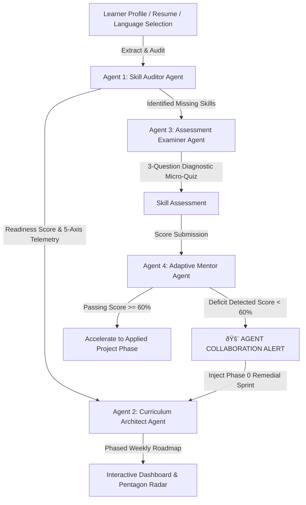

# THIRAN VAZHI — Universal Multi-Agent Career & Learning Engine

<p align="center">
  
</p>

<p align="center">
  <strong>Universal Multi-Agent Career Engineering &bull; All University &amp; Enterprise Disciplines &bull; Closed-Loop Remediation &bull; Multilingual AI</strong>
</p>

<p align="center">
  
  
  
  
  
  
</p>

---

## 📌 Executive Summary & Universal Problem Statement

### The Problem
Career transitions and university-to-workforce onboarding fail because traditional education relies on **static, one-size-fits-all curricula**:
- A **Chemistry graduate** transitioning to **Pharmaceutical Formulation** is bombarded with generic textbook chemistry while receiving zero structured guidance on USP Dissolution testing apparatus, formulation excipients, or FDA GMP cleanroom documentation.
- A **Commerce student** wanting to enter **Investment Banking** struggles to bridge basic accounting into dynamic 3-statement financial models and DCF sensitivity analyses.
- When learners fail a concept or diagnostic challenge, traditional platforms simply mark it as "failed" and advance regardless, resulting in **knowledge compounding errors and high dropout rates**.

### The Solution: THIRAN VAZHI (Universal Career Engine)
**THIRAN VAZHI** expands beyond software into **EVERY university and industry domain in the world** (Sciences, Engineering, Healthcare, Finance, Law, Technology, Agriculture, and Humanities). Four collaborative AI agents evaluate verified candidate competencies, assign empirical readiness scores, formulate customized weekly roadmaps, and activate an **Adaptive Feedback Loop**: if a student scores below 60% on a diagnostic micro-quiz or switches career tracks, the **Adaptive Mentor Agent** triggers an alert and commands the **Curriculum Architect Agent** to dynamically rewrite the roadmap with **Phase 0 Foundation Remedial Modules**.

---

## 🌟 Executive Platform Innovations

### 1. 🌐 Regional Multilingual AI Engine (5 Languages)
THIRAN VAZHI provides an integrated Language Selector in the top navigation header supporting:
- **English**
- **Tamil (தமிழ்)**
- **Hindi (हिन्दी)**
- **Telugu (తెలుగు)**
- **Malayalam (മലയാളം)**

When a language is selected, the platform passes it to the multi-agent backend (`/api/agents`), prompting the 4 AI agents to synthesize mentor advice, phased curriculum descriptions, and diagnostic assessments in the candidate's chosen language while maintaining standardized technical terms!

### 2. âš¡ Free Fire-Style 5-Axis Pentagon Radar Chart
On the **Skill Gap & Readiness** tab, THIRAN VAZHI renders a pure SVG 5-axis attribute pentagon (reminiscent of the Free Fire character attribute radar) plotting 5 core dimensions:
1. **Domain Mastery** (Core theoretical principles)
2. **Practical Execution** (Hands-on instrumentation & implementation)
3. **Analytical Problem Solving** (Diagnostics & algorithmic reasoning)
4. **Industry Tools & Compliance** (Regulatory standards, SOPs, and certifications)
5. **Communication & Leadership** (Executive synthesis and cross-disciplinary delivery)

Features concentric pentagon grid lines (20%, 40%, 60%, 80%, 100%), dual polygon overlays (Turquoise candidate mastery glow vs. Burgundy benchmark target outline), vertex dots, and outer attribute labels.

### 3. 🎯 Personal Career Goals & Milestone Improvement Tracker
A dedicated **Goals & Milestones** workspace where users can:
- Define short-term sprints (1–4 weeks) and long-term milestones (1–6 months).
- Assign target deadlines and competency domain tags.
- One-click auto-generate milestones directly from missing skills flagged by the **Skill Auditor Agent (Agent 1)**.
- Track overall milestone progress with real-time browser `localStorage` persistence.

### 4. 📄 Interactive Resume Builder & Instant PDF Export
A dedicated **Resume Builder** workspace that dynamically synchronizes with the user's profile, verified skills, projects, and AI Readiness Score:
- **Profile Headshot Upload**: Browser-side FileReader headshot preview without external cloud dependencies.
- **3 Distinct Executive Layout Styles**:
  1. *Executive Burgundy Classic*: Formal prestige header, burgundy accent bar, clean editorial columns.
  2. *Modern Turquoise Split*: Two-column contemporary sidebar layout highlighting skills and readiness index.
  3. *Minimal Academic Serif*: Clean centered editorial layout tailored for research, sciences, medicine, and law.
- **One-Click Download / Print**: Print-ready CSS (`@media print`) allowing instant PDF generation via `window.print()`.

---

## 🌐 Universal Career Domains & Presets

THIRAN VAZHI provides an indexed, searchable directory of **30+ career pathways across 6 major academic & enterprise faculties**, plus a **Custom Career Target** mode capable of analyzing any role in the world:

1. **Engineering & Core Tech**: Full Stack Developer, AI/ML Engineer, Mechanical Design Engineer, Embedded Systems Engineer, Civil & Structural Engineer, Robotics Engineer.
2. **Sciences, Chemistry & Pharma**: Analytical Chemist, Pharmaceutical Formulation Scientist, Clinical Research Associate, Biotechnology Researcher, Environmental Scientist, Materials Scientist.
3. **Healthcare & Medicine**: Medical Doctor / Resident, Clinical Pharmacist, Healthcare Data Analyst, Public Health Specialist, Physiotherapist.
4. **Business, Finance & Management**: Chartered Accountant, Digital Marketing Strategist, Financial Analyst, HR Partner, Investment Banking Analyst, Product Manager, Supply Chain Manager.
5. **Law, Policy & Humanities**: Academic Professor, Corporate Lawyer, Economist, Intellectual Property Attorney, Mass Media Producer, UX/UI Designer.
6. **Agriculture & Sustainability**: Agronomist, Food Safety Officer, Renewable Energy Consultant.

### 🌟 3 Diverse 1-Click Sample Presets:
- **💻 CS Student &rarr; Full Stack Developer**: Python, SQL, HTML &rarr; Identifies React, Node.js gaps.
- **🧪 Chemistry Grad &rarr; Pharma Formulation Scientist**: Organic Chemistry, Titration, HPLC &rarr; Identifies USP Dissolution, Noyes-Whitney kinetics, and GMP gaps.
- **📊 Commerce Grad &rarr; Financial Analyst**: Excel, Accounting, Business Communication &rarr; Identifies dynamic 3-statement modeling, DCF valuation, and WACC gaps.

---

## 🤖 Multi-Agent Architecture



### Agent Roles & Key Responsibilities

| Agent | Roster Title | Universal Domain Responsibility | Output & Deliverables |
|---|---|---|---|
| **Agent 1** | **Skill Auditor Agent** | Audits candidate skills against university & industry benchmarks across 5 domain pillars. | • Calibrated **Job Readiness Score (0–100%)**<br>• Matched Strengths vs Critical Gaps<br>• 5-Axis Attribute Radar Telemetry |
| **Agent 2** | **Curriculum Architect Agent** | Constructs week-by-week learning roadmaps featuring authentic lab simulations, models, or projects. | • Phased learning paths<br>• Duration & focus skills<br>• Dynamic `isRemedial` flag handling |
| **Agent 3** | **Assessment Examiner Agent** | Formulates diagnostic challenges targeting specific conceptual misconceptions. | • 3-question diagnostic micro-quiz<br>• High-discrimination distractors<br>• Deep technical explanations |
| **Agent 4** | **Adaptive Mentor Agent** *(Winning Hook)* | Monitors quiz telemetry and career pivot requests in real-time. | • Dynamic Intervention Alerts<br>• Automated roadmap rewriting<br>• Multilingual strategic chat counsel |
| **Agent 5** | **Roleplay Simulator Agent** | Simulates high-stakes workplace dilemmas as a realistic VP, lab director, or client. | • 3-turn interactive dilemma protocol<br>• Real-time Competency Score (0–100)<br>• Technical strength/flaw evaluations |

---

## 📚 150+ Searchable Real-World Skills Database

Users can search, filter, and multi-select from an alphabetically indexed database of **150+ cross-disciplinary skills**, or type and add ANY custom skill in the world:
- *Sciences*: Analytical Chemistry, Bioinformatics, Cell Culture, Chromatography, Dissolution Testing, HPLC, Mass Spectrometry, NMR Spectroscopy, Organic Synthesis, PCR, Pharmacokinetics, Titration.
- *Engineering*: AutoCAD, CAD/CAM Modeling, CFD, Civil Structural Codes, Circuit Design, Embedded C, FEA, MATLAB, PLC Programming, Robotics Kinematics, SolidWorks, Thermodynamics.
- *Finance & Business*: Accounting, Asset Valuation, Budgeting, Corporate Finance, DCF Valuation, Excel, Financial Modeling, GAAP, M&A, Risk Assessment, Six Sigma, Supply Chain.
- *Technology*: AWS, Big Data, Docker, Deep Learning, GraphQL, Kubernetes, Next.js, Python, PyTorch, React, SQL, Vector Databases.
- *Law & Health*: Clinical Trials, Contract Negotiation, Critical Care, FDA Regulatory Submissions, GCP/GLP/GMP, Intellectual Property, Medical Terminology, Patent Filing, Toxicology.

---

## 🎨 Google-Clean Editorial Design System

- **Executive Color Palette**:
  - **White & Warm Alabaster** (`#FFFFFF` cards on `#FAF8F8` canvas) with crisp 1px borders and subtle shadow layers.
  - **Deep Burgundy** (`#6D1A36` with hover `#521228`) for executive header navigation, section headings, and primary buttons.
  - **Turquoise Blue** (`#0D9488` / `teal-600` and `cyan-500`) for active tabs, gauge rings, progress tracks, and AI active status badges.
- **Classic Editorial Typography**:
  - **Libre Baskerville** (`--font-heading`, serif): High-elegance editorial titles and metric typography.
  - **Source Sans 3** (`--font-sans`): Clear, highly legible Google-style body text.
  - **JetBrains Mono** (`--font-mono`): Monospace uppercase tracking-wider labels for metrics and agent pills.

---

## 🚀 Quick Start & Setup

### Prerequisites
- Node.js 18+ (tested on Node.js 20 & 22)
- Gemini API Key from [Google AI Studio](https://aistudio.google.com/)

### 1. Installation
```bash
git clone <repository-url>
cd PromptWars-RTC/starter-app
```

### 2. Environment Configuration
Verify or create `.env.local`:
```env
GEMINI_API_KEY=your_gemini_api_key_here
```

### 3. Run Development Server
```bash
npm run dev
```
Open **http://localhost:3000** in your browser.

---

## 🎬 3-Minute Live Demo Walkthrough (For Judges)

1. **Multilingual Selection & Universal Role Selection (0:00–0:45)**:
   - Toggle the Language Selector in the top bar to **Tamil (தமிழ்)** or **Hindi (हिन्दी)**.
   - Click the **"🧪 Chemistry &rarr; Pharma Formulation Scientist"** preset.
   - Observe the 4 agent cards evaluate HPLC and Organic Chemistry strengths, mapping missing gaps in USP Dissolution and Drug Delivery Systems in the chosen language.
2. **Pentagon Radar Chart & Domain Benchmark (0:45–1:15)**:
   - On the **"Skill Gap & Readiness"** tab, show the **5-Axis Pentagon Radar Chart** plotting candidate attributes against target benchmarks with dual polygon overlays.
3. **The Adaptive Failure Hook (1:15–2:00)**:
   - Switch to the **"Skill Assessment"** tab and take the diagnostic quiz.
   - Intentionally fail the quiz ($0/3$ or $1/3$) and click **"Auto-Adapt Roadmap with Mentor Agent"**.
   - Watch the **Dynamic Agent Collaboration Alert** illuminate and dynamically inject **Phase 0 (Emergency Remedial Lab Sprint)** into the roadmap!
4. **Goals Tracker & Resume Builder (2:00–3:00)**:
   - Switch to **"Goals & Milestones"**: click a 1-click suggested goal from Agent 1's missing skills and check off a completed sprint with real-time localStorage sync.
   - Switch to **"Resume Builder"**: switch between *Executive Burgundy Classic*, *Modern Turquoise Split*, and *Minimal Academic Serif*, upload a headshot photo, and trigger **Download / Print Resume (PDF)**!

